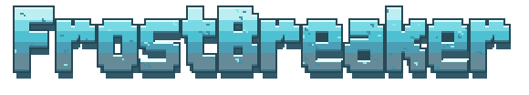
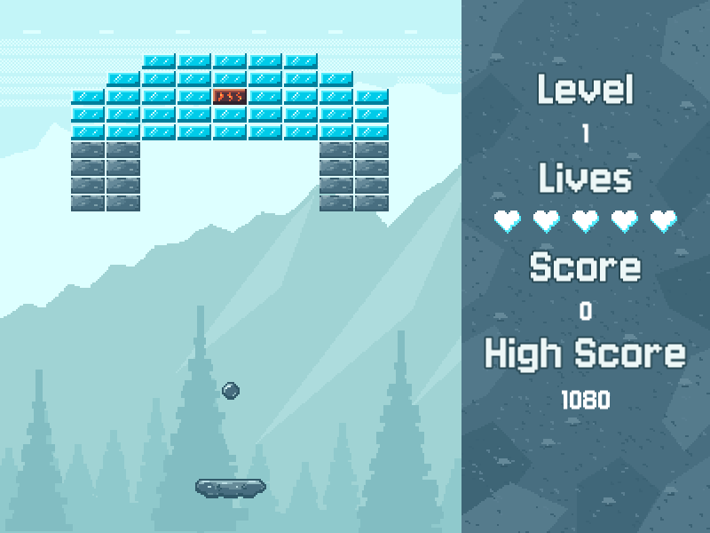
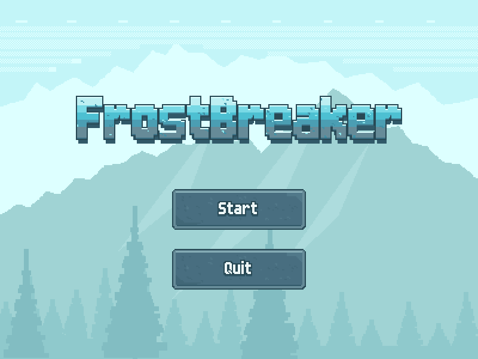
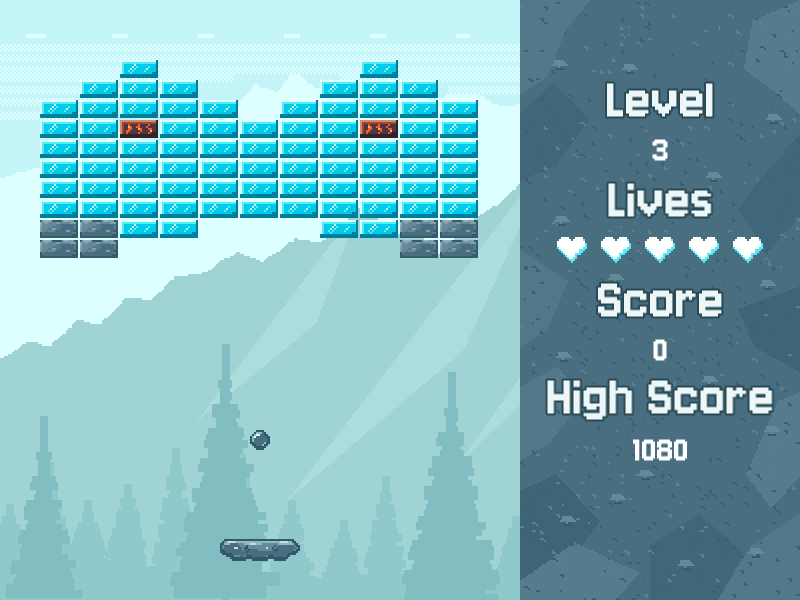
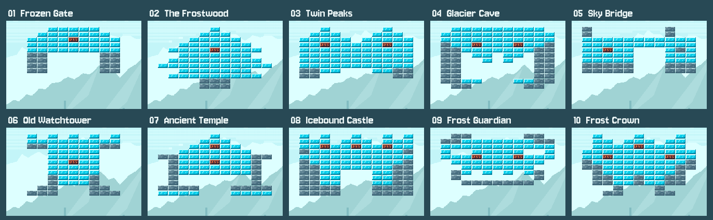

<p align="center"></p>

<p align="center">A pixel-art brick breaker through a frozen valley.<br>Ten levels. Five lives. Guarded lava bricks that add ten seconds of fire.</p>

<p align="center"><a href="https://github.com/Gr33nOps/Frost-Breaker/releases/latest">Download the game</a> · <a href="docs/itch-upload.md">Upload to itch.io</a> · <a href="THIRD_PARTY.md">Credits</a></p>



## Play

Download the **Windows ZIP** from [Releases](https://github.com/Gr33nOps/Frost-Breaker/releases/latest), extract it, then run **Play.cmd**. Keep the extracted folders together. No editor or compiler is required.

The **web ZIP** is ready for an itch.io HTML game upload. The itch.io play link will be added here once the page is published.

| Action | Control |
| --- | --- |
| Move | Mouse or Left / Right |
| Launch | Left click or Space |
| Pause / resume | Escape |
| Restart after a win or game over | Play Again or Space |
| Mute audio in browser | Music button or M |

Break every frost brick to advance. Rock blocks are permanent obstacles. Each level has one to three guarded lava bricks, arranged to suit its formation. Every pickup adds **10 seconds** to your remaining lava time. While active, the ball passes through frost; walls, rocks and the paddle still bounce it. The sidebar shows the countdown, which freezes when paused. Lava also clears when you lose a life or enter the next level. Your five lives last for the whole campaign, and your best score is saved locally.

## A journey through the valley

Frozen Gate → The Frostwood → Twin Peaks → Glacier Cave → Sky Bridge → Old Watchtower → Ancient Temple → Icebound Castle → Frost Guardian → Frost Crown.

<p> </p>

[](docs/media/campaign-preview.png)

Small previews of all ten levels. [Full-size screenshots](docs/media/levels) show each level with the normal stone ball.

The game includes editable pixel artwork, animated glints and fragments, original chiptune music, and arcade sound effects. The browser and Windows versions share the same artwork and level layouts.

## Build and test

**Windows:** Install Visual Studio with **Desktop development with C++**, then run:

```bat
build.cmd
tests\run-tests.cmd
Play.cmd
```

The included SFML 2.6.1 libraries target **Win32 / x86**. Open `Frost Breaker.sln` for the IDE, or use `build.cmd Debug` for a debug build.

**Browser:** Install Python 3 and Node.js 20 or newer. No npm packages are needed.

```sh
npm test
python scripts/package_release.py --web-only
python -m http.server 8000 --directory dist/web
```

Open `http://localhost:8000`. Serve the files over HTTP; opening `index.html` directly does not load JavaScript modules. The game makes no network requests beyond its own local resources.

**Packages:** After a Windows Release build, run `python scripts/package_release.py`, then `python tests/verify_release.py`. The resulting ZIPs and SHA-256 checksums are in `dist/`. [Release and itch.io instructions](docs/itch-upload.md) describe each download.

## Project layout

| Folder | Contents |
| --- | --- |
| `src/` | C++ game, swept collision geometry, campaign layouts |
| `web/` | Browser game: canvas rendering, input and Web Audio |
| `assets/images/`, `assets/animations/`, `assets/sounds/` | Game-ready artwork and audio |
| `assets/aseprite/`, `assets/manual-redraw/`, `assets/branding/` | Editable pixel-art sources |
| `assets/audio-source/` | BeepBox songs and jsfxr effect patches |
| `scripts/` | Builds, packaging, artwork exports and campaign playtests |
| `tests/` | Physics, game-state, artwork, audio and package checks |
| `docs/` | Screenshots, cover art and itch.io page copy |
| `third_party/` | SFML headers, libraries and licenses |

`bin/`, `build/`, `dist/`, personal scores and local backups are excluded from Git. `src/Levels.cpp` is the source of all ten formations; packaging exports those layouts to the browser automatically.

## License

By **Zain Mahmood / Gr33nOps**. Source code and original assets use the [MIT license](LICENSE). Fonts, SFML and Microsoft runtime files retain their own licenses; see [credits](THIRD_PARTY.md).
